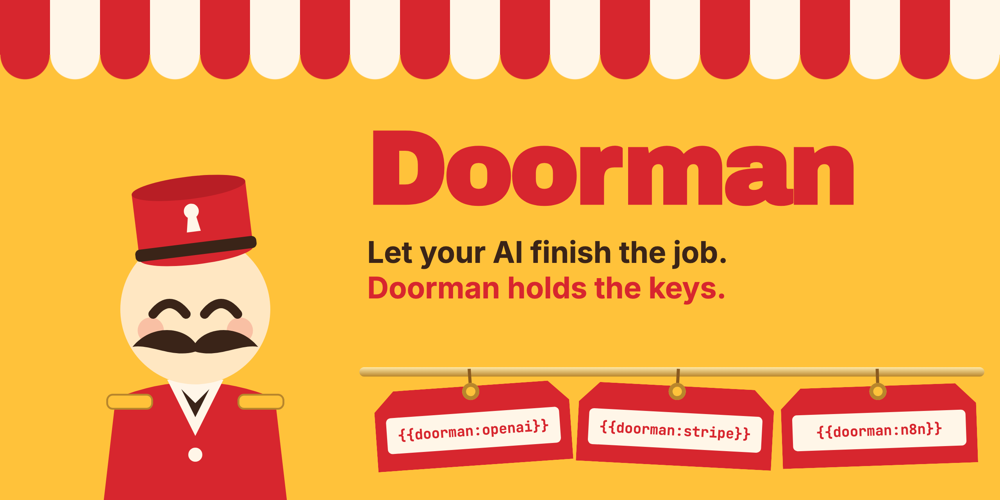
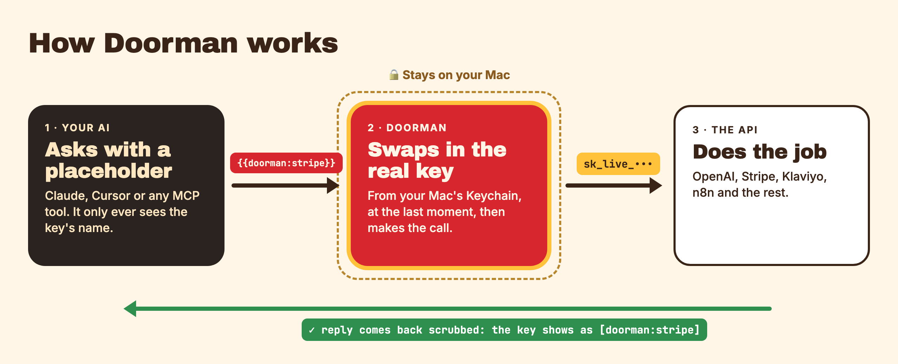
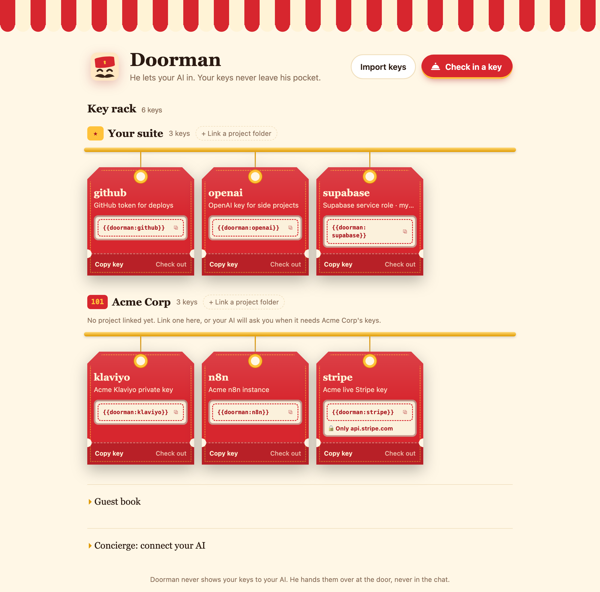

<p align="center">
  
</p>

<p align="center">
  <a href="https://github.com/Billylions/doorman/releases/latest"></a>
  
  
  
</p>

# Doorman 🛎️

**Let your AI finish the job, without getting stuck on keys.**

Your AI can build the n8n flow, set up Klaviyo, wire up Supabase and ship the deploy, right up until it needs an API key. Then it stops and waits for you.

Doorman removes that bottleneck. Check your keys in once, and your AI (Claude Code, Cursor, Claude Desktop or any MCP client) uses them through placeholders like `{{doorman:stripe}}` and keeps going to the end. Doorman holds the keys *for* your AI, on your Mac, so they never land in the chat either.

*Give your AI access without giving it the keys.*

<table>
  <tr>
    <td align="center" width="50%"><br><b>Your keys go on Doorman's rack.</b><br>Your AI only ever gets the tag.</td>
    <td align="center" width="50%"><br><b>Your AI finishes the job.</b><br>Every step gets keyed. No stopping to ask you.</td>
  </tr>
</table>

## Install

For Macs with Apple Silicon (M1 or later). Pick one:

**1. Paste one line into Terminal** (easiest)

```bash
curl -fsSL https://raw.githubusercontent.com/Billylions/doorman/main/install.sh | bash
```

This puts Doorman in Applications, adds the `doorman` command, connects it to Claude Code if you have it, and opens the app. Installed this way, macOS shows no security warning. [Read the script](install.sh) first if you like; it never touches your keys.

**2. Let your AI install it**

Paste this into Claude Code, Cursor or any AI tool that can run commands:

> Install Doorman for me from github.com/Billylions/doorman using its install.sh, then connect it to yourself.

**3. Download it**

Get `Doorman-mac-arm64.zip` from the [latest release](https://github.com/Billylions/doorman/releases/latest), unzip it and drag Doorman into Applications. Doorman isn't signed with an Apple Developer ID yet, so the first time you open a downloaded copy macOS says it can't verify it:

1. Click **Done** on the warning.
2. Open **System Settings → Privacy & Security**, scroll down and click **Open Anyway** next to Doorman.

You only do this once.

**Then:** open Doorman, check in your keys (paste them, or import a `.env` file), start a new chat with your AI and ask it to do the job.

## Why it exists

AI coding tools are now good enough to do real work for you: create the Stripe product, set up the Klaviyo flow, wire a key into n8n, deploy the app. The keys are what slow them down.

**The AI keeps stopping.** Halfway through the job it pauses to ask for a key, and everything waits until you come back, find the key and paste it. Then it needs the next one. You end up babysitting the run instead of letting it finish.

**And pasting keys into the chat is risky.** Once a key is in the chat, it is in the model's context, your chat history, your transcripts, logs and sometimes the provider's servers. You can't take it back. So people either accept that risk or do the step by hand, which defeats the point of having an AI do it.

## The goal

**Let the AI finish the whole job, while someone else holds the keys.**

- **No key bottleneck.** The AI doesn't stop to ask you for a key mid-task. Check a key in once, and Claude (or any AI tool) finishes the flow, the setup or the deploy on its own.
- The keys stay on your device, in your Mac's Keychain. They are never uploaded anywhere or pasted into a chat.
- The AI gets a *name* for each key, never the value.
- You add a key once, in Doorman, not in a chat.
- No approval pop-ups or extra steps in your way. Doorman stays out of it unless you tell it to lock a key down.
- It works for your own keys and for each client you work with, without mixing them up.

## How it works

<p align="center"></p>

Think of a hotel doorman. Guests (your AI) don't carry the room keys. They tell the doorman which room they need, he opens the door for them, and the keys never leave the front desk. Your Mac is the front desk.

1. **You check a key in.** Paste it into Doorman's window, import a `.env` file, or paste a whole note of keys. Doorman stores the value in your **macOS Keychain** and gives it a short name such as `stripe`.
2. **The AI uses a placeholder.** It sees only `{{doorman:stripe}}` and writes that wherever the key belongs: an API header, a URL, a request body, or a shell command.
3. **Doorman swaps it in at the last moment.** When the AI calls Doorman's `http_request` or `run_command` tool, Doorman puts the real key in place of the placeholder, makes the call from your Mac, and gets the result.
4. **Doorman scrubs what comes back.** If the key appears anywhere in the response or command output, even base64- or URL-encoded, it is replaced with `[doorman:stripe]` before the AI reads it.
5. **Everything is logged.** The Guest book shows which key was used, where and when, but never the value.

```
You:        "Add a Stripe customer for test@example.com"
AI calls:   http_request  Authorization: Bearer {{doorman:stripe}}
Doorman:    injects the real key → sends → scrubs response
AI sees:    HTTP 200 {"id": "cus_…", …}   (the key shows as [doorman:stripe] if echoed)
```

The AI gets the job done, and the key never enters the chat, the model's context or your transcripts.

## What you get

- **Keys live in your macOS Keychain**, never in plain files. Only names, descriptions and usual hosts are stored in `~/.doorman/vault.json`.
- **No gatekeeping by default.** Your AI can send a key to any HTTPS host it needs: the API itself, your n8n, Zapier or Make. Doorman notes the usual host (`api.stripe.com`) as a hint only. If you want a key to go to one place only, tick **Only ever send it to the hosts above** (or `doorman add --lock-hosts`), and Doorman blocks and logs anything else.
- **HTTPS only.** Plain HTTP is allowed only for localhost.
- **Output scrubbing.** Every known key, plus its base64 and URL-encoded forms, is replaced with `[doorman:name]` in responses and command output.
- **Audit log.** See which key the AI used, where and when (never the value): `doorman log`, or the Guest book in the app.
- **The AI asks, you paste.** When the AI needs a key you haven't added, it calls `request_secret`. Doorman opens a check-in card with the form pre-filled; you paste the key there, not in the chat, and the AI carries on.
- **Your AI already knows the rules.** When an AI tool connects, Doorman tells it how to behave: never ask for keys in chat, check `list_secrets` first, use placeholders, and ask through `request_secret`. You don't have to explain anything.

## The Mac app

Doorman is a native Mac app with his hat in your menu bar.

<p align="center"></p>
<p align="center"><sub>The key rack, shown with demo keys.</sub></p>

- **Front desk window:** each key hangs on the key rack as a room-key fob. Click the placeholder on a fob to copy it. **Check in a key** adds one, **Check out** removes it, and the **Guest book** shows what your AI did, including requests Doorman *stopped at the door*.
- **Import .env:** click **Import .env** or drop a `.env` file anywhere on the window. Doorman ticks the variables that look like credentials, guesses which API each one belongs to (`STRIPE_SECRET_KEY` → `api.stripe.com`), and checks them in under short names (`stripe`). Your `.env` file is not changed.
- **Menu bar (his hat):** open the front desk, check in a key, copy the Claude Code setup command, install the `doorman` command, or turn on Open at login. Closing the window keeps Doorman running in the menu bar.
- **When your AI needs a key**, it opens Doorman through a `doorman://add?...` link with the form pre-filled. If the app isn't installed, it falls back to a local browser page.
- **No Node needed.** The app runs the MCP server itself.

### Build it

Requires macOS and Node 20+ to build.

```bash
npm install
npm run dist        # → dist/mac-arm64/Doorman.app
```

Drag `Doorman.app` into `/Applications` and open it. Other scripts:

- `npm run app` runs it without packaging.
- `npm run icons` regenerates the icons; then rebuild `build/icon.icns`.

Intel Macs can build it this way too. The build is ad-hoc signed, not with an Apple Developer ID yet.

## Connect your AI

Use **menu bar → Copy Claude Code setup command**, paste it in a terminal and run it once. With the app in `/Applications` it looks like:

```bash
claude mcp add --scope user doorman -e ELECTRON_RUN_AS_NODE=1 -- "/Applications/Doorman.app/Contents/MacOS/Doorman" "/Applications/Doorman.app/Contents/Resources/app/src/cli.js" mcp
```

For Cursor (`~/.cursor/mcp.json`) or Claude Desktop, use the JSON shown in the app under "Connect your AI".

## Rooms: keys for each client

If you work for several clients, each one gets a **room**, and your own keys live in **Your suite**.

- **Each project folder is linked to a room.** In a folder linked to Acme, `{{doorman:stripe}}` and `doorman run` use **Acme's** Stripe key. If Acme doesn't have that key, Doorman uses yours. Other clients' keys can never be used there.
- **Doorman never guesses.** In a folder that isn't linked yet, only your own keys work. If the key only exists for clients, the AI is told to ask you which client the project is for and then call `link_project`. The Doorman window shows a **Link a project to a client** card, and nothing changes until you confirm it.
- **Your key never stands in for the client's.** If a client has its own key for the same service under another name, Doorman tells the AI to use that one instead of falling back to yours.
- **Importing notes:** paste a client's note and Doorman suggests the client from its title (`Acme Corp`, `Client: Acme Corp` or `Acme Corp — API keys`). Generic titles like "My API keys" and service names like "Stripe" are never taken as a client.

```bash
doorman link "Acme Corp"         # link the current folder (or: doorman link mine)
doorman where                    # which client this folder belongs to
doorman rooms                    # clients, linked folders and key counts
doorman import --clipboard --client "Acme Corp"
```

You can also commit a `.doorman` file containing `client: Acme Corp` to a project. It holds no keys and links the folder for anyone using Doorman.

## The `doorman` command

Install it from **menu bar → Install the doorman command…** (it goes in `~/.local/bin`, no admin needed). From a source checkout, run `node src/cli.js install-cli` instead.

### Move your keys out of `.env`

```bash
doorman import .env          # previews, then checks in every key that looks like a credential
```

### Run anything with your keys: `doorman run`

```bash
doorman run -- npm run dev
doorman run --only stripe -- node scripts/charge.js
doorman run --env-file .env.doorman -- python app.py
```

Your program gets each key as its usual environment variable (`STRIPE_SECRET_KEY`, `OPENAI_API_KEY`, …), so your code doesn't change and no `.env` file with real keys needs to sit on disk.

- Every key is passed in unless you turned off **Can be used in commands** for it.
- `--env-file` loads a file where values can be placeholders, e.g. `PAYMENTS_KEY={{doorman:stripe}}`. That file is safe to commit.
- When you run it in a terminal, output goes straight through. When something captures the output, such as an AI agent, a script or a pipe, known key values are scrubbed from it.
- This works with any AI tool that can run terminal commands, not just MCP clients.

### Other commands

```bash
doorman add stripe --desc "Stripe test key" --hosts api.stripe.com --env STRIPE_SECRET_KEY
doorman list
doorman log
doorman rm stripe
doorman setup        # setup snippets for Claude Code / Cursor
```

Then just ask your AI to do things. It will call `list_secrets` to see what's available.

## Tools exposed to the AI

| Tool | What it does |
| --- | --- |
| `list_secrets` | Names, descriptions, placeholders and allowed hosts. Never values. |
| `http_request` | HTTP call with `{{doorman:name}}` in the URL, headers or body. Any HTTPS host unless you locked the key; redirects not followed. |
| `run_command` | Shell command with placeholders passed as env vars (`$DOORMAN_NAME`). |
| `request_secret` | Opens the Doorman check-in card (for this project's client) so the user can add a missing key. |
| `link_project` | Asks the user to confirm which client a project folder belongs to. |

## Security model (read this)

**What Doorman guarantees:** the key never appears in the chat, the model's context or your transcripts, and it is scrubbed from anything the AI reads back.

**What it doesn't do by default:** decide where a key may go. Keys work with any HTTPS host and in commands, so a confused AI or a prompt injection could send one somewhere you didn't intend. For keys where that matters, lock them to their hosts and turn off **Can be used in commands**; Doorman then enforces both.

**Not protected against:**
- Malware already running as your user. It can read your Keychain prompts and memory the same way it could anything else.
- Keys you paste into chat yourself. Doorman can't un-send them, which is why it exists.
- "Copy key" in the UI. It puts the value on your clipboard and tries to clear it after 30 seconds. Anything you paste it into keeps it.

**The local UI** binds to `127.0.0.1` only, needs a random per-launch token and rejects foreign `Host` headers (DNS rebinding).

## Development

```bash
npm test     # unit tests + end-to-end (real MCP client, real Keychain, isolated service name)
```

Set `DOORMAN_HOME` and `DOORMAN_SERVICE` to use a separate vault while developing.

## Roadmap ideas

- Linux (libsecret) and Windows (Credential Manager) backends
- Per-key method/path rules (e.g. GET only, `/v1/customers/*`)
- Expiring keys and one-time grants ("allow for the next 10 minutes")
- Team sync and shared audit log (paid tier)

## License

MIT
